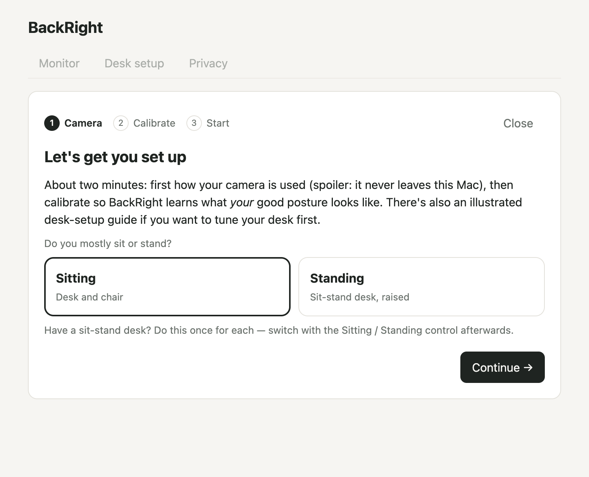
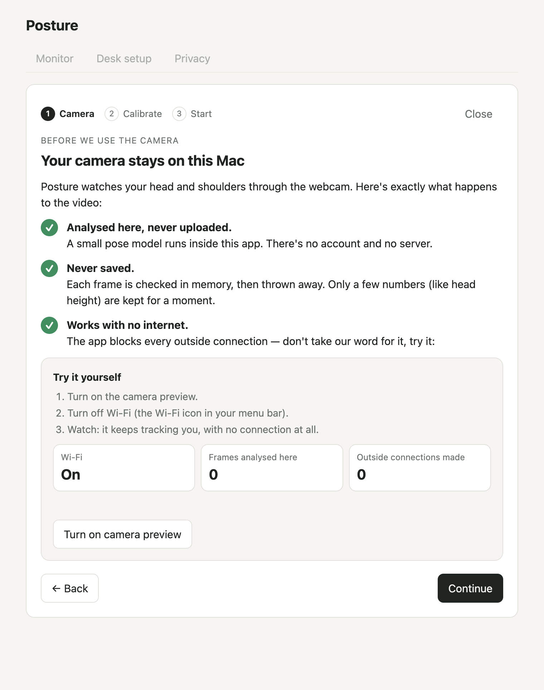
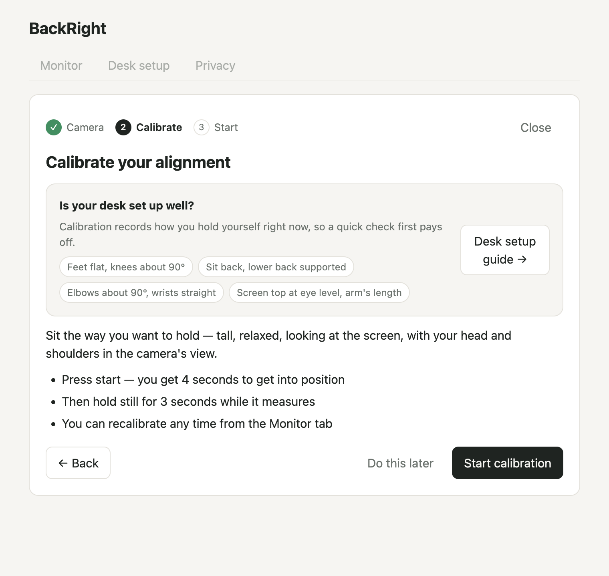
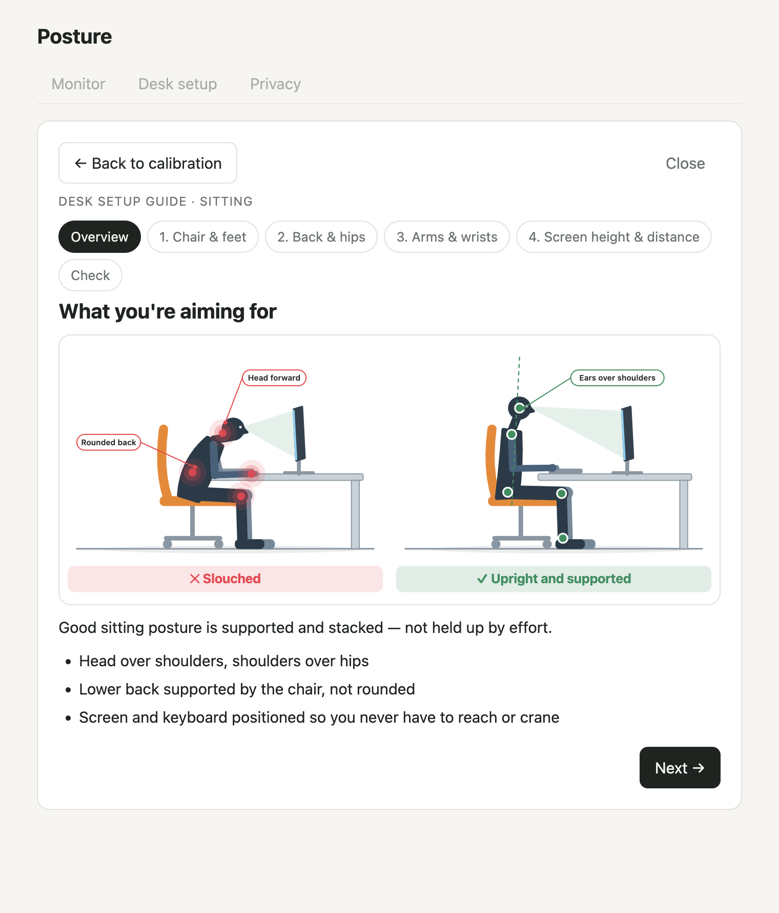
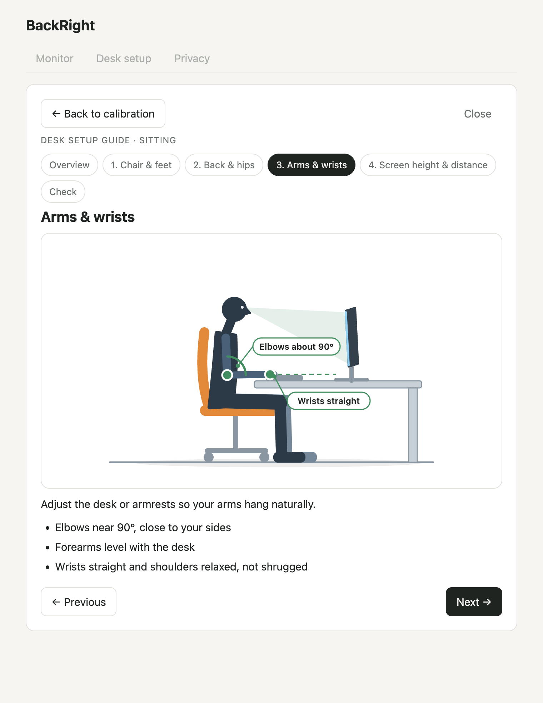
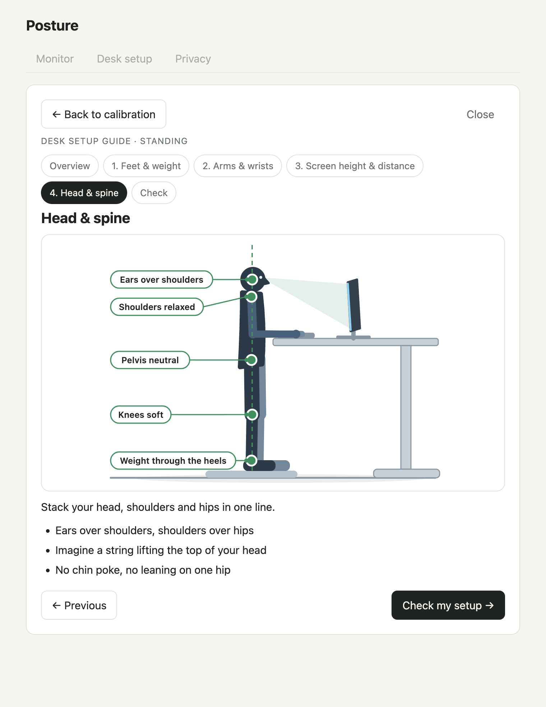
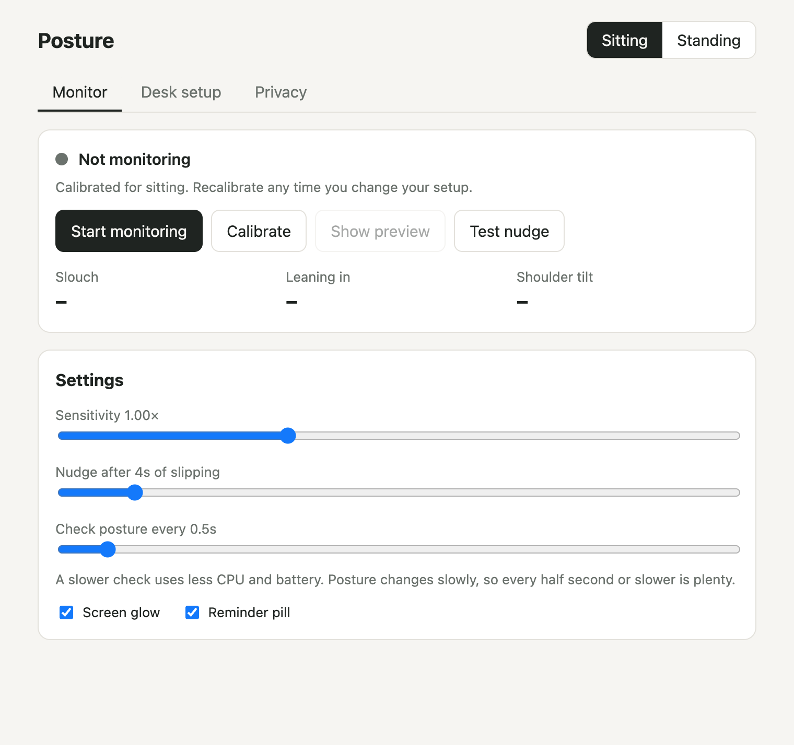
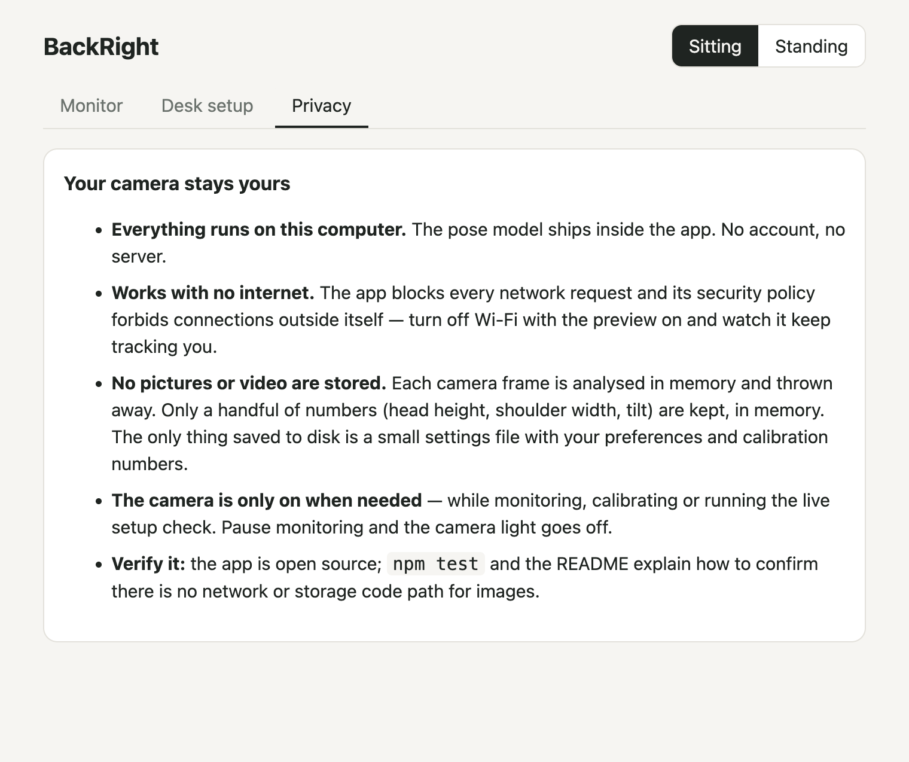
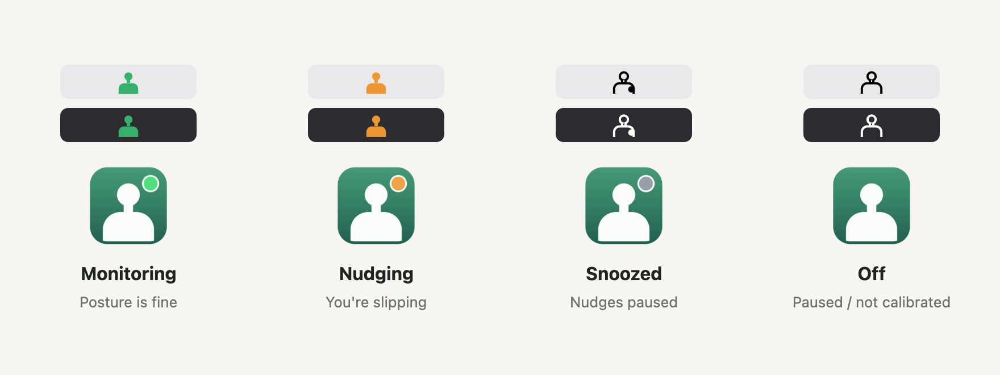
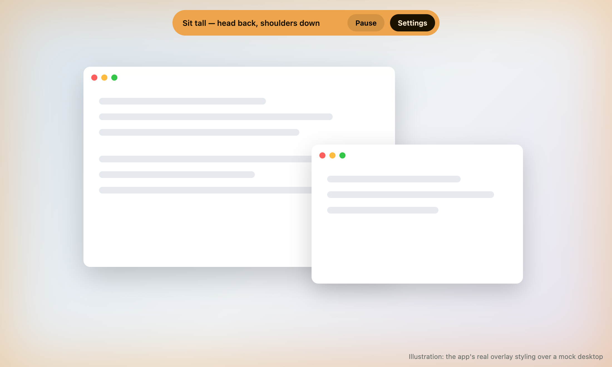

# BackRight

**BackRight** is a small desktop app that watches your posture through the webcam and gives a faint, screen-wide nudge when you slip. Works for sitting and standing desks. **Everything runs on your computer — no images are stored or sent anywhere.**

> Status: early release (v0.1). Electron, macOS-first (Apple Silicon and Intel); Windows should largely work but is untested.

## Download

**[Download BackRight 0.1.0](https://github.com/lylerbaumgarten/backright/releases/latest)** (macOS 13 or newer)

| Your Mac | Installer |
|---|---|
| Apple Silicon (M1, M2, M3, M4…) | `BackRight-0.1.0-arm64.dmg` |
| Intel | `BackRight-0.1.0-x64.dmg` |

Not sure which? Apple menu → **About This Mac**: *Chip: Apple M…* = Apple Silicon, *Processor: Intel…* = Intel.

BackRight isn't notarized (that needs a paid Apple developer account), so macOS blocks the first launch: open the app, click **Done**, then **System Settings → Privacy & Security → Open Anyway**. Step-by-step instructions are inside the disk image and in the [release notes](https://github.com/lylerbaumgarten/backright/releases/tag/v0.1.0). Prefer not to trust a download? Everything is open source — build it yourself below.

> **Not a medical device.** BackRight is an ergonomics reminder, not medical advice. If you have pain, see a professional.

## Screenshots

<table>
  <tr>
    <td width="50%"><br><sub><b>1.</b> Welcome — sitting or standing, each calibrated separately</sub></td>
    <td width="50%"><br><sub><b>2.</b> Camera &amp; privacy — what happens to the video, and a Wi-Fi-off test you can run yourself</sub></td>
  </tr>
  <tr>
    <td><br><sub><b>3.</b> Calibrate — with the optional desk-setup guide one click away</sub></td>
    <td><br><sub><b>4.</b> Desk setup guide — what you're aiming for</sub></td>
  </tr>
  <tr>
    <td><br><sub><b>5.</b> One page per step (sitting)…</sub></td>
    <td><br><sub><b>6.</b> …and a separate set for standing desks</sub></td>
  </tr>
  <tr>
    <td><br><sub><b>7.</b> Monitor — sensitivity, delay and how often to check</sub></td>
    <td><br><sub><b>8.</b> Privacy — always one tab away</sub></td>
  </tr>
</table>

**Status at a glance** — the menu-bar icon and the Dock icon both follow what the app is doing (illustration composed from the app's real icon files):



**The nudge** — a faint glow around the screen edges plus a small pill with *Pause* and *Settings*. It never steals focus and stays out of screenshots (illustration: the app's real overlay styling over a mock desktop):



<sub>Screenshots are generated from the running app by `npm run docs:screenshots` (macOS). They never switch the camera on, so there is no live camera preview among them.</sub>

## Requirements

macOS 13+ on Apple Silicon or Intel (Windows should largely work but is untested) · Node.js 22 or newer · a webcam. First run downloads Electron (~100 MB) and the pose model (~6 MB); after that the app needs no internet.

## Run it

```bash
npm install     # also copies the MediaPipe runtime and downloads the pose model into ./vendor (one time)
npm start
```

**On macOS, install it as a real app:** `npm run app` builds a standalone `BackRight.app` (own name, icon and camera permission, code bundled inside), installs it to `~/Applications`, and launches it. After that it lives in the Dock, Launchpad and Spotlight — closing the window leaves it running, and clicking the Dock icon brings the window back. Right-click its Dock icon → Options → Keep in Dock to pin it. `npm run dev:app` does the same without installing (runs `build/BackRight.app`), `-- --debug` opens a DevTools port, `-- --rebuild` recreates the bundle (macOS will ask for camera access again). `npm start` runs the plain Electron binary, which macOS blames for camera access — avoid it for camera testing.

Re-run `npm run app` after code changes to refresh the installed copy.

**Building installers:** `npm run release:mac` builds a disk image for Apple Silicon (`arm64`) and one for Intel (`x64`) into `dist/` (add `-- --arch=x64` for just one). The Intel Electron is downloaded from Electron's releases and checked against the checksum published in the `electron` package. The images are ad-hoc signed, not notarized, so macOS asks the user to confirm the first launch (see the instructions inside each image).

**Start over (for testing):** `npm run fresh` quits the app, deletes saved settings and relaunches into the first-run walkthrough. Add `-- --camera` to also reset the macOS camera permission, `-- --all` to wipe the whole data folder.

Grant camera access when asked. A tray/menu-bar icon keeps it running in the background; the window hides when closed.

**Troubleshooting:** run the app from Terminal with logging on — `BACKRIGHT_DEBUG=1 /Applications/BackRight.app/Contents/MacOS/Electron` — to see messages such as how long the pose model took to load and whether it runs on the GPU or the CPU.

## Menu-bar icon = status

| Icon | Meaning |
|---|---|
| **Green** figure | Monitoring, posture fine |
| **Amber** figure | You're being nudged right now |
| Grey outline | Paused, not calibrated yet, or screen locked |
| Outline + dot | Nudges snoozed |

Hover it for a tooltip with the same in words; the menu's top line says it too.

## How to use it

1. **Welcome** — pick Sitting or Standing (each has its own calibration).
2. **Camera & privacy** — what happens to the video, with a live preview you can test with Wi-Fi off.
3. **Calibrate** — hold the posture you want to keep for a few seconds. That's your baseline. Not sure your desk is set up well? Open the **Desk setup guide** from this screen: an illustrated sub-page (overview, one page per step, and a camera check) that returns you to calibration.
4. **Start monitoring.** If you drift from the baseline (head dropping toward your shoulders, leaning toward the screen, shoulders uneven) for a few seconds, a soft glow appears around every screen. It fades when you correct.

The guide is also in the **Desk setup** tab any time, and a reminder banner on the Monitor tab appears until you've been through it.

## Privacy — how it's enforced

- **Local only.** The pose model (MediaPipe Pose Landmarker, lite) is bundled in `vendor/`; nothing is fetched at runtime.
- **Network blocked.** The main process cancels every request that isn't the app's own `app://` content, and the CSP is `default-src 'none'; connect-src 'self'`. Offline behaves identically.
- **No frames kept.** A frame is analysed in memory and dropped. Only landmark-derived numbers exist afterwards. The only file written is `settings.json` (your preferences and calibration numbers) in the app's user-data folder.
- **Camera only when needed.** The camera stream is opened for monitoring, calibration or the live setup check, and closed otherwise, so the camera light goes off when paused or when the screen is locked.
- **Tiny bridge.** The renderer talks to the main process through a preload with a handful of settings/boolean calls — there's no channel that carries image data.
- **Prove it yourself.** The onboarding's privacy step shows a live camera preview with counters — frames analysed on this Mac, outside connections made (always 0, they're all blocked) and Wi-Fi state. Turn off Wi-Fi and watch the posture check keep running.
- **Tripwire tests.** `npm test` fails if source starts using frame-capture, recording, network or storage APIs (`test/privacy.test.mjs`).

## Layout

```
src/main/       Electron main: tray, per-display overlay windows, network lockdown, settings
src/renderer/   Panel UI, pose detection, posture maths (posture.js is pure and unit-tested)
vendor/         MediaPipe runtime + model (generated by `npm run vendor`, git-ignored)
test/           Unit tests for the posture maths and privacy guardrails
```

## Known limits / next

- Front-facing webcam only; no view of the lower body, so knee/hip checks in desk setup are best-effort and fall back to the written checklist.
- Performance not yet profiled — sampling is every 0.5 s by default; the interval is adjustable. Still-frame sampling and CPU/battery measurement are a later pass.
- The screen glow is drawn as four thin edge strips per display (not one full-screen window), shown only while a nudge is up, and flagged as excluded from screenshots/recordings. A full-screen window gets picked by macOS window-capture (⇧⌘4 → Space) as "the window under the cursor" and then can't be captured; strips leave the middle of the screen free. The reminder pill has **Pause** (stops monitoring and turns the camera off) and **Settings** (brings the app to the front, even if it was closed to the menu bar). Tray menu → **Snooze nudges** pauses the glow for 5 min / 30 min / 1 h (handy for screen shares).
- Overlay over true full-screen apps on macOS/Windows needs real-world testing.
- Not yet packaged/signed for distribution.

## License

MIT — see [LICENSE](LICENSE). BackRight bundles Electron (MIT), MediaPipe Tasks Vision (Apache-2.0) and Google's BlazePose GHUM pose model (Apache-2.0); see [THIRD_PARTY_NOTICES.md](THIRD_PARTY_NOTICES.md).
